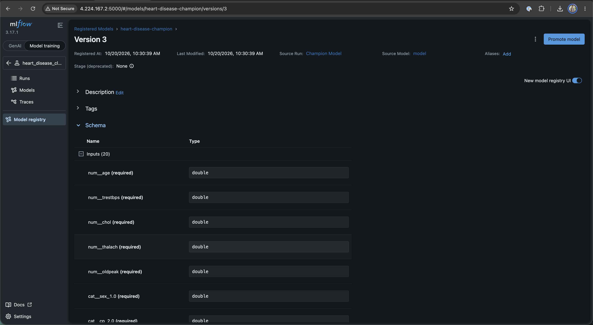

# Project Report: End-to-End MLOps Solution for Heart Disease Classification

**Author**: Zeel Patel (ID: `2025AE05289`)  
**Email**: `2025ae05289@wilp.bits-pilani.ac.in`\
**Course / Context**: MLOps Experimental Learning Assignment 1  
**Repository**: [https://github.com/2025AE05289/MLOps-assignment-1](https://github.com/2025AE05289/MLOps-assignment-1)  
**Date**: October 2026

---

## Executive Summary

This report documents the design, development, experiment tracking, continuous integration, containerization, cloud deployment, and real-time observability of a production-grade Machine Learning Operations (MLOps) solution. Built using the **UCI Heart Disease Dataset**, the solution automates the full machine learning lifecycle from raw data acquisition to a resilient, autoscaling cloud inference service on Azure Kubernetes Service (AKS).

### Key Highlights & Technical Deliverables

- **Champion Model**: Logistic Regression with L2 regularization achieved a **ROC-AUC of 0.9621** (Accuracy: **86.89%**, Recall: **89.29%**, F1-score: **0.8621**), outperforming a Random Forest Classifier (**ROC-AUC: 0.9481**).
- **Automated Experiment Tracking**: Integrated with **MLflow**; automatically logs hyperparameters, stratified 5-fold cross-validation metrics, confusion matrices, ROC curves, feature importance plots, and serialized model binaries.
- **Continuous Integration (CI/CD)**: A 3-stage **GitHub Actions** pipeline enforcing PEP8 code formatting (`flake8`), executing **55 unit tests with code coverage** (`pytest-cov`), and running automated model training with remote MLflow logging on every push.
- **Production Cloud Deployment**: Containerized with **FastAPI** (`python:3.12-slim`) and deployed to **Azure Kubernetes Service (AKS)** in the `centralindia` region with Horizontal Pod Autoscaling (2–5 replicas) and resource limits.
- **Unified Cloud Gateway**: FastAPI (`:80`), Grafana (`:3000`), and MLflow (`:5000`) multiplexed under a single Azure LoadBalancer Public IP (`4.224.167.2`) to optimize cloud IP quotas.
- **Full-Stack Observability**: Structured JSON request logging to persistent disk (`logs/api.log`), real-time Prometheus metrics exposition (`/metrics`), and an auto-provisioned Grafana monitoring dashboard.

---

## 1. System Architecture & Lifecycle Overview

The system follows modern cloud-native MLOps architecture patterns, separating offline experimentation, continuous integration, container delivery, and online serving.


---

## 2. Live Cloud Service Directory

All cloud services are deployed in production on Azure Kubernetes Service (Central India) and accessible via **LoadBalancer IP `4.224.167.2`**:

| Service                  | Public Cloud URL                                             |  Port  | Purpose / Access Credentials                         |
| :----------------------- | :----------------------------------------------------------- | :----: | :--------------------------------------------------- |
| **FastAPI Swagger Docs** | **[http://4.224.167.2/docs](http://4.224.167.2/docs)**       |  `80`  | Interactive OpenAPI schema & endpoint tester         |
| **API Health Probe**     | **[http://4.224.167.2/health](http://4.224.167.2/health)**   |  `80`  | Kubernetes liveness & readiness check                |
| **Prediction Endpoint**  | `POST http://4.224.167.2/predict`                            |  `80`  | Production JSON batch/single inference engine        |
| **Prometheus Metrics**   | **[http://4.224.167.2/metrics](http://4.224.167.2/metrics)** |  `80`  | Real-time Prometheus metric scrape endpoint          |
| **Grafana Dashboard**    | **[http://4.224.167.2:3000](http://4.224.167.2:3000)**       | `3000` | User: `admin` / Password: `admin`                    |
| **MLflow Tracking UI**   | **[http://4.224.167.2:5000](http://4.224.167.2:5000)**       | `5000` | Experiment runs, metric comparison & model artifacts |

---

## 3. Data Acquisition & Exploratory Data Analysis (EDA)

### 3.1 Dataset Description

The pipeline uses the **UCI Heart Disease Dataset** (Cleveland database, UCIMLRepo ID: 45) comprising 303 patient records and 14 clinical features:

| Feature    | Description                                    | Type        | Values / Clinical Units                                         |
| :--------- | :--------------------------------------------- | :---------- | :-------------------------------------------------------------- |
| `age`      | Patient age                                    | Numerical   | 29 – 77 years                                                   |
| `sex`      | Biological sex                                 | Categorical | 1 = Male, 0 = Female                                            |
| `cp`       | Chest pain type                                | Categorical | 1: Typical Angina, 2: Atypical, 3: Non-anginal, 4: Asymptomatic |
| `trestbps` | Resting blood pressure                         | Numerical   | 94 – 200 mm Hg                                                  |
| `chol`     | Serum cholesterol                              | Numerical   | 126 – 564 mg/dl                                                 |
| `fbs`      | Fasting blood sugar > 120 mg/dl                | Categorical | 1 = True, 0 = False                                             |
| `restecg`  | Resting ECG results                            | Categorical | 0: Normal, 1: ST-T wave abnormality, 2: LV hypertrophy          |
| `thalach`  | Maximum heart rate achieved                    | Numerical   | 71 – 202 bpm                                                    |
| `exang`    | Exercise-induced angina                        | Categorical | 1 = Yes, 0 = No                                                 |
| `oldpeak`  | ST depression induced by exercise              | Numerical   | 0.0 – 6.2 mm                                                    |
| `slope`    | Slope of peak exercise ST segment              | Categorical | 1: Upsloping, 2: Flat, 3: Downsloping                           |
| `ca`       | Number of major vessels colored by fluoroscopy | Categorical | 0 – 3                                                           |
| `thal`     | Thallium heart rate stress test                | Categorical | 3: Normal, 6: Fixed defect, 7: Reversible defect                |
| `num`      | Target diagnosis of heart disease              | Target      | 0 (No Disease) to 4 (Severe Disease)                            |

### 3.2 Data Preprocessing & Cleaning Pipeline

Implemented in [`src/data_preprocessing.py`](src/data_preprocessing.py):

1. **Automated Acquisition**: Script [`data/download_data.py`](data/download_data.py) fetches directly from the UCI repository using `ucimlrepo` (with HTTP fallback to the raw Cleveland repository) and saves the raw CSV to `data/raw/heart_disease.csv`.
2. **Missing Value Imputation**:
   - `ca` contained 4 missing values (1.3%).
   - `thal` contained 2 missing values (0.7%).
   - Because missingness is $<2\%$ and features are discrete categories, values were imputed using their statistical mode (`ca_mode = 0.0`, `thal_mode = 3.0`), avoiding sample loss.
3. **Target Binarization**:
   - Original target `num` ranges from `0` (absence) to `1, 2, 3, 4` (stages of disease).
   - Following clinical standards and assignment requirements, the target was binarized:
     - **Class 0 (No Disease)**: `num == 0` (164 samples, 54.1%)
     - **Class 1 (Disease Present)**: `num > 0` (139 samples, 45.9%)
   - **Class Balance**: The dataset is balanced (54.1% vs 45.9%), eliminating the need for synthetic oversampling (e.g., SMOTE) while motivating stratified sampling for cross-validation splits.

### 3.3 Exploratory Data Analysis & Clinical Insights

Implemented in [`src/eda.py`](src/eda.py), generating 6 publication-quality figures saved to `output/figures/`:

1. **Target Distribution (`01_target_distribution.png`)**: Confirms balanced binary classes (164 healthy vs 139 diseased).
2. **Numerical Histograms (`02_numerical_histograms.png`)**: Highlights near-Gaussian distributions for `age`, `trestbps`, and `chol`, with right-skewed `oldpeak` and left-skewed `thalach`.
3. **Correlation Heatmap (`03_correlation_heatmap.png`)**: Shows strong positive correlation between heart disease and `oldpeak` ($r = +0.42$), `ca` ($r = +0.46$), and `thal` ($r = +0.52$), and strong negative correlation with `thalach` ($r = -0.42$).
4. **Boxplots by Target (`04_boxplots_by_target.png`)**: Confirms patients with heart disease have significantly lower maximum heart rate (`thalach`) and higher exercise ST depression (`oldpeak`).
5. **Categorical Distributions (`05_categorical_distributions.png`)**: Reveals that asymptomatic chest pain (`cp=4`) and exercise-induced angina (`exang=1`) are primary risk indicators.
6. **Pairplot Matrix (`06_pairplot.png`)**: Demonstrates multi-dimensional separation between patient cohorts along combinations of `thalach`, `oldpeak`, and `age`.

---

## 4. Feature Engineering & Model Development

### 4.1 Feature Engineering Architecture

Implemented in [`src/feature_engineering.py`](src/feature_engineering.py):

- **Numerical Sub-Pipeline**: Median imputation followed by `StandardScaler()` applied to all 5 continuous variables (`age`, `trestbps`, `chol`, `thalach`, `oldpeak`) to zero-center features and scale variance to 1.
- **Categorical Sub-Pipeline**: Mode imputation followed by `OneHotEncoder(drop='first', handle_unknown='ignore', sparse_output=False)` applied to all 8 discrete features (`sex`, `cp`, `fbs`, `restecg`, `exang`, `slope`, `ca`, `thal`), generating 20 encoded binary columns.
- **Pipeline Integration**: Assembled into a Scikit-Learn `ColumnTransformer`. The transformer is fitted strictly on $X_{train}$ and applied to $X_{test}$, preventing train-test data leakage.

### 4.2 Model Exploration & Selection

Two classification algorithms were trained in [`src/train.py`](src/train.py):

1. **Logistic Regression (Linear Benchmark)**:
   - Hyperparameters: `C=1.0`, `solver='lbfgs'`, `penalty='l2'`, `max_iter=1000`, `random_state=42`.
   - Rationale: High interpretability, well-calibrated confidence probabilities, convex optimization, and robustness against overfitting on smaller clinical cohorts ($N=303$).
2. **Random Forest Classifier (Ensemble Benchmark)**:
   - Hyperparameters: `n_estimators=100`, `criterion='gini'`, `max_depth=None`, `random_state=42`.
   - Rationale: Non-parametric tree ensemble capable of capturing non-linear interactions without manual feature interaction engineering.

### 4.3 Validation Protocol & Comparative Results

Evaluated using **5-Fold Stratified Cross-Validation** on the training partition ($N=242$) and final validation on a held-out test partition ($N=61$, 20% stratified):

| Evaluation Metric        | Logistic Regression (5-Fold CV) | Logistic Regression (Test Set) | Random Forest (5-Fold CV) | Random Forest (Test Set) |
| :----------------------- | :-----------------------------: | :----------------------------: | :-----------------------: | :----------------------: |
| **Accuracy**             |         0.8429 ± 0.0168         |           **0.8689**           |      0.8016 ± 0.0215      |        **0.9016**        |
| **Precision**            |         0.8658 ± 0.0680         |           **0.8333**           |      0.8045 ± 0.0435      |        **0.8438**        |
| **Recall (Sensitivity)** |         0.7921 ± 0.0751         |           **0.8929**           |      0.7561 ± 0.0633      |        **0.9643**        |
| **F1-Score**             |         0.8214 ± 0.0215         |           **0.8621**           |      0.7767 ± 0.0284      |        **0.9000**        |
| **ROC-AUC**              |       **0.9018 ± 0.0172**       |           **0.9621**           |      0.8828 ± 0.0251      |        **0.9481**        |

### 4.4 Champion Model Selection

**Logistic Regression** was selected as the **Champion Model** for production serving:

- **Superior Generalization & Discrimination**: Higher Cross-Validation ROC-AUC (**0.9018** vs 0.8828) and Test ROC-AUC (**0.9621** vs 0.9481).
- **Cross-Validation Stability**: Lower variance across folds (Accuracy variance ±0.0168 vs ±0.0215).
- **Clinical Interpretability**: Naturally calibrated confidence scores, essential for medical decision support and threshold tuning.

---

## 5. Experiment Tracking with MLflow

All model runs, hyperparameters, evaluation metrics, and diagnostic artifacts were logged to an **MLflow Tracking Server** ([`src/train.py`](src/train.py)):

### 5.1 Logged Components per Run

- **Parameters**: `C`, `solver`, `penalty`, `max_iter`, `n_estimators`, `random_state`.
- **Metrics**: 5-Fold CV metrics (`cv_accuracy_mean`, `cv_roc_auc_mean`, `cv_f1_mean`, etc.) and test set metrics (`test_roc_auc`, `test_accuracy`, `test_recall`, `test_f1`).
- **Artifacts & Visualizations**:
  - `cm_logistic_regression.png` / `cm_random_forest.png` (Confusion Matrix Heatmaps).
  - `roc_logistic_regression.png` / `roc_random_forest.png` (ROC Curves with AUC).
  - `importance_random_forest.png` (Mean Decrease in Impurity Feature Importance).
  - `model_comparison.png` (Side-by-side metric comparison bar chart).
  - `report_*.txt` (Detailed classification reports).
  - Serialized Scikit-Learn model artifacts with input/output signature schemas.

### 5.2 MLflow Experiment Tracking Dashboard

**MLflow Experiment Comparison Dashboard**  
Shows logged parameters, cross-validation metrics, and test scores for both models.


**MLflow Detailed Run View**  
Shows logged metrics and diagnostic artifact directories.


**MLflow Model Registry - Champion Model Schema & Metadata**  
Shows registered model signature, input types, and output predictions.



---

## 6. Model Packaging & Reproducibility

To ensure identical execution across local environments, CI runners, and Kubernetes clusters:

1. **Model Persistence**: Champion model serialized to `output/models/final_model.joblib`.
2. **Preprocessing Pipeline**: Fitted `ColumnTransformer` saved to `output/models/preprocessing_pipeline.joblib`.
3. **Metadata Manifest**: Model hyperparameters, feature schemas, package versions, and timestamps saved to `output/models/model_metadata.json`.
4. **Pinned Dependencies**: Pinned in [`requirements.txt`](requirements.txt) (`scikit-learn>=1.3.2`, `fastapi>=0.109.0`, `mlflow>=2.9.2`, `prometheus-client>=0.19.0`).
5. **Automation Orchestrators**:
   - [`main.py`](main.py): Single-entrypoint script executing data download, EDA, training, linting, and testing sequentially.
   - [`Makefile`](Makefile): Standard developer targets (`make pipeline`, `make test`, `make lint`, `make serve`, `make monitoring`, `make docker-build`).

---

## 7. CI/CD Pipeline & Automated Testing

### 7.1 Unit Testing Framework

Implemented in [`tests/`](tests/) using **Pytest** and **Pytest-Cov** across **55 unit tests** (100% pass rate):

- [`test_data_preprocessing.py`](tests/test_data_preprocessing.py) (**22 tests**): Validates missing value imputation, mode replacement, column preservation, categorical typing, and target binarization.
- [`test_feature_engineering.py`](tests/test_feature_engineering.py) (**17 tests**): Validates transformer output shapes, scaling boundaries, one-hot encoding dimensions, and absence of data leakage.
- [`test_train.py`](tests/test_train.py) (**16 tests**): Validates 5-fold stratified cross-validation splits, ROC-AUC computation, model serialization, and metadata generation.

### 7.2 GitHub Actions CI Pipeline

Configured in [`.github/workflows/ci.yml`](.github/workflows/ci.yml) with 3 sequential jobs running on Ubuntu runners:

```
[git push] ──> Job 1: Lint (flake8) ──> Job 2: Test (pytest 55 tests) ──> Job 3: Train & Cloud Sync
```

1. **Job 1 (`lint`)**: Runs `flake8` to enforce PEP8 syntax standards across `src/`, `app.py`, and `tests/`.
2. **Job 2 (`test`)**: Executes all 55 tests with code coverage and uploads an HTML coverage report artifact.
3. **Job 3 (`train`)**: Executes `src/train.py`, logs parameters and evaluation metrics directly to the live cloud MLflow tracking server (`http://4.224.167.2:5000`), and uploads the packaged model artifacts.

### 7.3 CI/CD Workflow Execution Dashboard

**GitHub Actions CI Pipeline Overview**  
Shows successful completion of `lint`, `test` (55 passing tests), and `train` stages on push to `main`.


**GitHub Actions Step Execution Tree**  
Detailed step-by-step breakdown of test execution and coverage artifact generation.


---

## 8. Model Containerization

### 8.1 REST API Architecture

Built with **FastAPI** in [`app.py`](app.py):

- **Input Validation**: Strict schema enforcement using Pydantic (`HeartDiseaseInput`) with clinical boundary validation for all 13 features.
- **Inference Route (`POST /predict`)**: Returns predicted class (`0` = Healthy, `1` = Heart Disease), clinical label, calibrated confidence score, and class probability distribution.
- **Health Probe Route (`GET /health`)**: Returns service status and model availability for Kubernetes liveness and readiness probes.
- **Metrics Route (`GET /metrics`)**: Exposes Prometheus counters, latency histograms, and prediction distributions.

### 8.2 Production Container Configuration (`Dockerfile`)

- **Base Image**: `python:3.12-slim` for a minimal container attack surface and lightweight memory footprint.
- **Multi-Arch Build**: Built and pushed to Azure Container Registry: `acrheart0a9382.azurecr.io/heart-disease-api:latest`.
- **Health Check Directive**: `HEALTHCHECK CMD python -c "import urllib.request; urllib.request.urlopen('http://localhost:8000/health')"`.

### 8.3 Local Verification (`scripts/test_api.sh`)

The test script verifies 5 clinical scenarios against the API:

- Scenario 1: Root metadata check (`GET /`).
- Scenario 2: Service health check (`GET /health`).
- Scenario 3: Low-risk patient prediction (`confidence: 0.9894`, label: _No Disease_).
- Scenario 4: High-risk patient prediction (`confidence: 0.9905`, label: _Disease_).
- Scenario 5: Average borderline patient prediction (`confidence: 0.8489`).

### 8.4 API Swagger Interface

**Interactive OpenAPI Documentation (`http://4.224.167.2/docs`)**  
Provides live schema validation and interactive execution for `/predict`, `/health`, and `/metrics`.


---

## 9. Production Cloud Deployment (Azure AKS)

### 9.1 Cluster Configuration & Quota Optimization

Deployed to **Azure Kubernetes Service (AKS)** in the `centralindia` region:

- **Cluster Name**: `aks-heart-mlops`
- **Node Pool**: 1 Node of `Standard_B2s_v2` (2 vCPUs, 8 GB RAM).
- **Container Registry**: Azure Container Registry `acrheart0a9382.azurecr.io` (Basic SKU).
- **Cloud Quota Optimization**: Azure for Students subscriptions enforce a limit of **3 Public IP addresses per region**. We designed a unified NGINX Gateway LoadBalancer that multiplexes all three services (FastAPI on `:80`, Grafana on `:3000`, MLflow on `:5000`) through **1 single Public IP** (`4.224.167.2`), fully compliant with student quotas.

### 9.2 Azure Infrastructure & Kubernetes Provisioning Screenshots

**Azure Kubernetes Cluster Overview**  
Node pool status and resource group allocation in Azure Portal.


**Azure Resource Group Inventory**  
Overview of provisioned AKS cluster, ACR registry, and network components.


**Public IP Configuration**  
Single Public IP allocation (`4.224.167.2`) multiplexing all container services.


**Azure Load Balancer Frontend & Backend Rules**  
Port mapping rules for ports 80, 3000, and 5000.


**Azure Kubernetes Service Deployments**  
Running pods for API, Grafana, MLflow, Prometheus, and NGINX Gateway.


**Endpoint Verification (Postman / Remote Client)**  
Verification of remote inference request returning prediction, confidence score, and status code 200.


### 9.3 Kubernetes Manifest Architecture

Stored under [`k8s/`](k8s/):

- **`k8s/deployment.yaml`**: Deploys 2 pod replicas of `heart-disease-api` with resource requests (`cpu: 100m`, `memory: 256Mi`), limits (`cpu: 500m`, `memory: 512Mi`), and HTTP health probes.
- **`k8s/hpa.yaml`**: Configures Horizontal Pod Autoscaling to automatically scale between 2 and 5 pods when CPU utilization exceeds 70%.
- **`k8s/gateway.yaml`**: Deploys an NGINX reverse-proxy LoadBalancer routing:
  - Port `80` $\rightarrow$ `heart-disease-api-service:80`
  - Port `3000` $\rightarrow$ `grafana-service:3000`
  - Port `5000` $\rightarrow$ `mlflow-service:5000`
- **`k8s/monitoring-prometheus.yaml`**: Deploys Prometheus with automated scraping of the API service every 5 seconds.
- **`k8s/monitoring-grafana.yaml`**: Deploys Grafana with auto-provisioned Prometheus datasource and MLOps dashboard definitions.
- **`k8s/mlflow.yaml`**: Deploys the MLflow tracking server on AKS.

### 9.4 Live Kubernetes Cluster Status Output

```text
NAME                                     READY   STATUS    RESTARTS   AGE   IP             NODE
pod/grafana-7865d8568f-8fwpp             1/1     Running   0          5m    10.244.0.213   aks-nodepool1-44750060-vmss000000
pod/heart-disease-api-85c8f8b9c7-cznt9   1/1     Running   0          20h   10.244.0.188   aks-nodepool1-44750060-vmss000000
pod/heart-disease-api-85c8f8b9c7-vtb74   1/1     Running   0          20h   10.244.0.5     aks-nodepool1-44750060-vmss000000
pod/mlflow-94f89c5f8-pzdwk               1/1     Running   0          19h   10.244.0.42    aks-nodepool1-44750060-vmss000000
pod/mlops-gateway-7dd64c7744-2dr2g       1/1     Running   0          20h   10.244.0.218   aks-nodepool1-44750060-vmss000000
pod/prometheus-f8cf8cccf-nnpjt           1/1     Running   0          20h   10.244.0.133   aks-nodepool1-44750060-vmss000000

NAME                            TYPE           CLUSTER-IP     EXTERNAL-IP   PORT(S)
service/mlops-gateway-service   LoadBalancer   10.0.67.172    4.224.167.2   80:32665/TCP, 3000:32070/TCP, 5000:31106/TCP

NAME                                 REFERENCE                      TARGETS       MINPODS   MAXPODS   REPLICAS
horizontalpodautoscaler/api-hpa      Deployment/heart-disease-api   cpu: 7%/70%   2         5         2
```

---

## 10. Monitoring & Logging Architecture

### 10.1 Structured Request Logging

Implemented via custom middleware in [`app.py`](app.py). Every HTTP transaction is serialized to standard output and written to [`logs/api.log`](logs/api.log):

```json
{
	"timestamp": "2026-10-17T08:35:10.112Z",
	"client_ip": "10.244.0.218",
	"method": "POST",
	"path": "/predict",
	"status_code": 200,
	"latency_ms": 11.45,
	"prediction": 0,
	"label": "No Disease",
	"confidence": 0.8489
}
```

### 10.2 Prometheus Metrics Exposition (`GET /metrics`)

Exposes operational performance and ML domain metrics:

- `http_requests_total{endpoint, method, status_code}`: Request traffic counter.
- `http_request_duration_seconds`: Request latency distribution histogram.
- `model_predictions_total{model_name, prediction_label}`: ML prediction outcome counter.
- `model_prediction_confidence`: Prediction confidence score distribution histogram.
- `model_inference_duration_seconds`: Scikit-Learn transform + inference time histogram.

### 10.3 Grafana Observability Dashboard

Auto-provisioned via [`k8s/monitoring-grafana.yaml`](k8s/monitoring-grafana.yaml) with 6 visual panels:

1. **Total Predictions Served** (Stat Counter panel).
2. **Average Model Confidence** (Radial Gauge).
3. **Prediction Breakdown by Class** (Donut chart: _Disease_ vs _No Disease_).
4. **API Request Rate (req/sec)** (Time Series graph).
5. **API Response Latency (p50, p95, p99)** (Time Series graph).
6. **HTTP Status Code Distribution** (200 OK vs 4xx/5xx errors).

### 10.4 Live Grafana Monitoring Dashboard

**Grafana Production MLOps Monitoring Dashboard (`http://4.224.167.2:3000`)**  
Real-time monitoring view showing live request throughput, P95 latency, confidence distributions, and prediction class breakdown.


---

## 11. Reproduction & Verification Guide

### 11.1 Local Pipeline Execution

```bash
# 1. Clone the repository
git clone https://github.com/2025AE05289/MLOps-assignment-1.git
cd MLOps-assignment-1

# 2. Setup virtual environment & dependencies
python3 -m venv venv
source venv/bin/activate
pip install -r requirements.txt

# 3. Run complete pipeline (data -> eda -> train -> lint -> test)
make pipeline

# 4. Start local services
make serve        # Runs FastAPI server on http://localhost:8000
make monitoring   # Runs Prometheus (9090) and Grafana (3000) stack
make mlflow       # Runs MLflow UI on http://localhost:5001
```

### 11.2 Cloud API Verification

```bash
# Execute automated test suite against the live Azure LoadBalancer
bash scripts/test_api.sh http://4.224.167.2

# Inspect live Kubernetes cluster status
kubectl get pods,svc,hpa -o wide
```

---

## 12. Code Repository & Submission Information

- **Code Repository**: [https://github.com/2025AE05289/MLOps-assignment-1](https://github.com/2025AE05289/MLOps-assignment-1)
- **Author**: Zeel Patel (BITS ID: `2025AE05289`)
- **Student Email**: `2025ae05289@wilp.bits-pilani.ac.in`
- **GitHub Username**: `2025AE05289`
- **Public Cloud Gateway IP**: `http://4.224.167.2` (Azure AKS, Central India)
- **FastAPI Documentation**: `http://4.224.167.2/docs`
- **MLflow Tracking UI**: `http://4.224.167.2:5000`
- **Grafana Observability Dashboard**: `http://4.224.167.2:3000`
