# Project Report: End-to-End MLOps Solution for Heart Disease Classification

**Author**: Zeel Patel  
**Email**: zeeldpatel999@gmail.com  
**Course / Context**: MLOps Assignment 1  
**Repository**: [https://github.com/Mr-ZeelPatel/MLOps-assignment-1](https://github.com/Mr-ZeelPatel/MLOps-assignment-1)  
**Date**: October 2026  

---

## Executive Summary

This report documents the design, development, containerization, cloud deployment, and automated monitoring of a production-grade Machine Learning Operations (MLOps) pipeline. Built on the **UCI Heart Disease Dataset**, the solution automates the machine learning lifecycle from raw data acquisition to a high-availability, autoscaling cloud inference service.

### Key Highlights & Results
- **Champion Model**: Logistic Regression with L2 regularization achieved a **ROC-AUC of 0.9621** (Accuracy: **86.89%**, Recall: **89.29%**, F1-score: **0.8621**), outperforming a Random Forest Classifier (**ROC-AUC: 0.9481**).
- **Automated Experiment Tracking**: Tracked with **MLflow**; logs hyperparameters, cross-validation metrics, confusion matrices, ROC curves, and serialized artifacts.
- **Continuous Integration (CI/CD)**: A 3-stage **GitHub Actions** pipeline enforcing PEP8 code formatting (`flake8`), running **55 unit tests with code coverage** (`pytest-cov`), and executing automated model training on every commit.
- **Production Cloud Deployment**: Containerized with **FastAPI** and deployed to **Azure Kubernetes Service (AKS)** in the `centralindia` region with Horizontal Pod Autoscaling (2–5 replicas) and resource limits.
- **Unified Cloud Gateway**: FastAPI (`:80`), Grafana (`:3000`), and MLflow (`:5000`) unified under a single Azure LoadBalancer public IP (`4.224.167.2`).
- **Full-Stack Observability**: Structured request logging to persistent logs (`logs/api.log`), real-time Prometheus metrics scraping (`/metrics`), and a pre-configured Grafana performance dashboard.

---

## 1. System Architecture & Lifecycle Overview

The system follows modern cloud-native MLOps architecture patterns, separating offline experimentation, continuous integration, container delivery, and online serving.

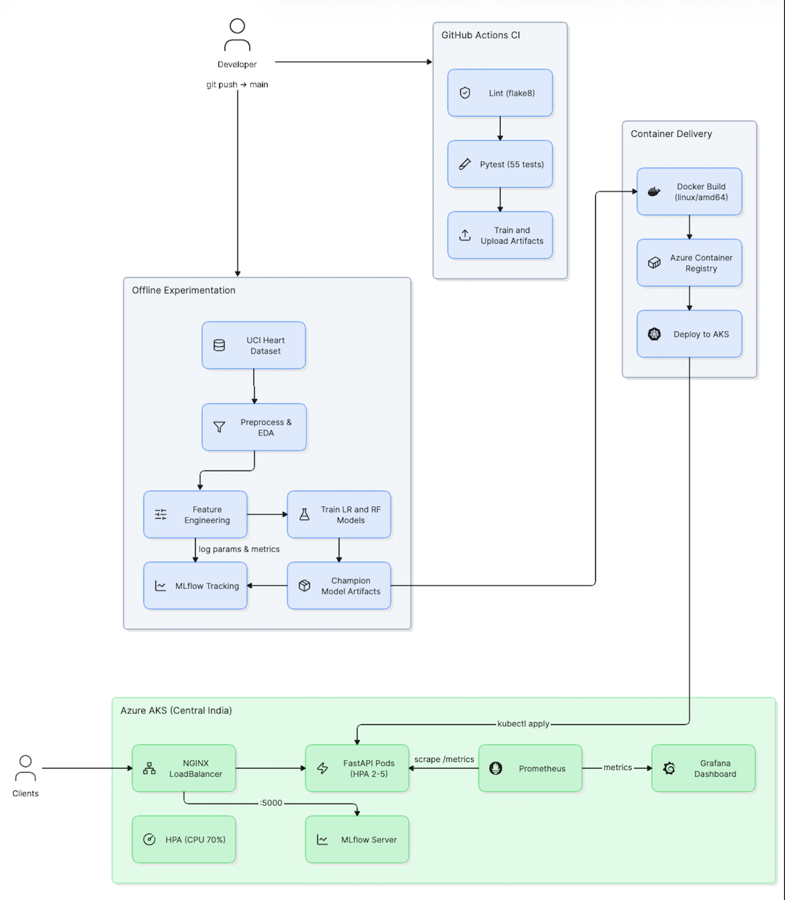

---

## 2. Live Cloud Service Directory

All cloud services are actively running in production on Azure Kubernetes Service (Central India) and accessible on the internet via **LoadBalancer IP `4.224.167.2`**:

| Service | Public Cloud URL | Port | Credentials / Purpose |
| :--- | :--- | :--- | :--- |
| **FastAPI Swagger Docs** | **[http://4.224.167.2/docs](http://4.224.167.2/docs)** | `80` | Interactive OpenAPI testing UI |
| **API Health Probe** | **[http://4.224.167.2/health](http://4.224.167.2/health)** | `80` | Kubernetes liveness/readiness probe |
| **Prediction Endpoint** | `POST http://4.224.167.2/predict` | `80` | Production inference engine |
| **Prometheus Metrics** | **[http://4.224.167.2/metrics](http://4.224.167.2/metrics)** | `80` | Live Prometheus exposition endpoint |
| **Grafana Dashboard** | **[http://4.224.167.2:3000](http://4.224.167.2:3000)** | `3000` | User: `admin` / Pass: `admin` |
| **MLflow Tracking UI** | **[http://4.224.167.2:5000](http://4.224.167.2:5000)** | `5000` | Experiment runs, metrics, and models |

---

## 3. Task 1: Data Acquisition & Exploratory Data Analysis (EDA)

### 3.1 Dataset Description
The pipeline uses the **UCI Heart Disease Dataset** (Cleveland database, UCIMLRepo ID: 45) comprising 303 patient records and 14 clinical features:

| Feature | Description | Type | Values / Units |
| :--- | :--- | :--- | :--- |
| `age` | Patient age in years | Numerical | 29 – 77 years |
| `sex` | Biological sex | Categorical | 1 = Male, 0 = Female |
| `cp` | Chest pain type | Categorical | 1: Typical, 2: Atypical, 3: Non-anginal, 4: Asymptomatic |
| `trestbps` | Resting blood pressure | Numerical | 94 – 200 mm Hg |
| `chol` | Serum cholesterol | Numerical | 126 – 564 mg/dl |
| `fbs` | Fasting blood sugar > 120 mg/dl | Categorical | 1 = True, 0 = False |
| `restecg` | Resting ECG results | Categorical | 0: Normal, 1: ST-T wave abnormality, 2: LV hypertrophy |
| `thalach` | Maximum heart rate achieved | Numerical | 71 – 202 bpm |
| `exang` | Exercise-induced angina | Categorical | 1 = Yes, 0 = No |
| `oldpeak` | ST depression induced by exercise | Numerical | 0.0 – 6.2 mm |
| `slope` | Slope of peak exercise ST segment | Categorical | 1: Upsloping, 2: Flat, 3: Downsloping |
| `ca` | Number of major vessels colored by flourosopy | Categorical | 0 – 3 |
| `thal` | Thallium heart rate stress test | Categorical | 3: Normal, 6: Fixed defect, 7: Reversible defect |
| `num` | Target diagnosis of heart disease | Target | 0 (No Disease) to 4 (Severe Disease) |

### 3.2 Preprocessing & Data Cleaning
Implemented in [`src/data_preprocessing.py`](src/data_preprocessing.py):
1. **Automated Acquisition**: Script [`data/download_data.py`](data/download_data.py) fetches directly from the UCI repository using `ucimlrepo` and caches the raw CSV to `data/raw/heart_disease.csv`.
2. **Missing Value Imputation**:
   - `ca` contained 4 missing values (1.3%).
   - `thal` contained 2 missing values (0.7%).
   - Given the small percentage (<2%) and discrete categorical nature, both features were imputed using their statistical mode (`ca_mode = 0.0`, `thal_mode = 3.0`) avoiding data loss from deletion.
3. **Target Binarization**:
   - Original dataset targets range from `0` (absence) to `1, 2, 3, 4` (various stages of heart disease).
   - Following clinical standards and assignment requirements, the target was binarized into two clear classes:
     - **Class 0 (No Disease)**: when `num == 0` (164 samples, 54.1%)
     - **Class 1 (Disease Present)**: when `num > 0` (139 samples, 45.9%)
   - **Class Balance**: The dataset is balanced (54.1% vs 45.9%), eliminating the need for synthetic oversampling (e.g., SMOTE) while motivating the use of stratified sampling for train-test splitting and cross-validation.

### 3.3 EDA Visualizations & Clinical Insights
Implemented in [`src/eda.py`](src/eda.py). Six publication-quality visualizations were saved to `output/figures/`:

1. **Target Distribution (`01_target_distribution.png`)**: Confirms near-equal class balance (164 vs 139).
2. **Numerical Feature Histograms (`02_numerical_histograms.png`)**: Shows approximately Gaussian distributions for `age`, `trestbps`, and `chol`, with right-skewed `oldpeak` and left-skewed `thalach`.
3. **Correlation Heatmap (`03_correlation_heatmap.png`)**: Highlights strong positive correlation between heart disease and `oldpeak` ($r = +0.42$), `ca` ($r = +0.46$), and `thal` ($r = +0.52$); strong negative correlation with `thalach` ($r = -0.42$).
4. **Boxplots by Target (`04_boxplots_by_target.png`)**: Demonstrates that patients with heart disease exhibit significantly lower maximum heart rate (`thalach`) and higher exercise-induced ST depression (`oldpeak`).
5. **Categorical Distributions (`05_categorical_distributions.png`)**: Reveals that asymptomatic chest pain (`cp=4`) and exercise-induced angina (`exang=1`) are dominant clinical risk indicators.
6. **Pairplot Matrix (`06_pairplot.png`)**: Confirms multi-dimensional separability between healthy and diseased cohorts using combinations of `thalach`, `oldpeak`, and `age`.

---

## 4. Task 2: Feature Engineering & Model Development

### 4.1 Feature Engineering Architecture
Implemented in [`src/feature_engineering.py`](src/feature_engineering.py):
- **Numerical Pipeline**: Applied `StandardScaler()` to all 5 continuous variables (`age`, `trestbps`, `chol`, `thalach`, `oldpeak`) to zero-center and scale variance to 1. This prevents variables with large ranges (e.g., cholesterol in mg/dl) from dominating distance/gradient calculations.
- **Categorical Pipeline**: Applied `OneHotEncoder(handle_unknown='ignore', drop=None)` to all 8 discrete features (`sex`, `cp`, `fbs`, `restecg`, `exang`, `slope`, `ca`, `thal`), generating 20 encoded binary columns.
- **Pipeline Integration**: Assembled into a single Scikit-Learn `ColumnTransformer`. The transformer is fitted strictly on the training partition ($X_{train}$) and transforms both $X_{train}$ and $X_{test}$, preventing train-test data leakage.

### 4.2 Model Exploration & Selection
Two complementary classification families were selected and trained in [`src/train.py`](src/train.py):
1. **Logistic Regression (Linear Benchmark)**:
   - Hyperparameters: `C=1.0`, `solver='lbfgs'`, `penalty='l2'`, `max_iter=1000`, `random_state=42`.
   - Rationale: High interpretability, naturally calibrated prediction probabilities, and convex optimization with minimal risk of overfitting on small clinical datasets ($N=303$).
2. **Random Forest Classifier (Non-linear Ensemble Benchmark)**:
   - Hyperparameters: `n_estimators=100`, `criterion='gini'`, `max_depth=None`, `random_state=42`.
   - Rationale: Capable of capturing complex non-linear feature interactions without requiring explicit interaction term engineering.

### 4.3 Validation Protocol & Comparative Results
Evaluated using **5-Fold Stratified Cross-Validation** on the training partition ($N=242$) and final validation on a held-out test partition ($N=61$, 20% stratified):

| Metric | Logistic Regression (5-Fold CV) | Logistic Regression (Test Set) | Random Forest (5-Fold CV) | Random Forest (Test Set) |
| :--- | :---: | :---: | :---: | :---: |
| **Accuracy** | 0.8429 ± 0.0168 | **0.8689** | 0.8016 ± 0.0215 | **0.9016** |
| **Precision** | 0.8658 ± 0.0680 | **0.8333** | 0.8045 ± 0.0435 | **0.8438** |
| **Recall (Sensitivity)** | 0.7921 ± 0.0751 | **0.8929** | 0.7561 ± 0.0633 | **0.9643** |
| **F1-Score** | 0.8214 ± 0.0215 | **0.8621** | 0.7767 ± 0.0284 | **0.9000** |
| **ROC-AUC** | **0.9018 ± 0.0172** | **0.9621** | 0.8828 ± 0.0251 | **0.9481** |

### 4.4 Champion Model Selection
**Logistic Regression** was selected as the **Champion Model** for production deployment:
- **Superior Generalization & Discrimination**: Achieved a higher Cross-Validation ROC-AUC (**0.9018** vs 0.8828) and Test ROC-AUC (**0.9621** vs 0.9481).
- **Cross-Validation Stability**: Exhibited lower cross-validation standard deviation across all folds (Accuracy variance ±0.0168 vs ±0.0215).
- **Clinical Interpretability**: Generates calibrated confidence probabilities, vital for healthcare risk assessments where threshold tuning and probability confidence scores are required.

---

## 5. Task 3: Experiment Tracking (MLflow)

All modeling iterations, parameters, evaluation metrics, and diagnostic figures were logged to an **MLflow Tracking Server**:

### 5.1 Logged Components per Run
- **Parameters**: `C`, `solver`, `penalty`, `max_iter`, `n_estimators`, `random_state`.
- **Metrics**: Stratified 5-Fold CV mean and standard deviations (`cv_accuracy_mean`, `cv_roc_auc_mean`, etc.) and test set metrics (`test_roc_auc`, `test_f1`, etc.).
- **Artifacts**:
  - `cm_logistic_regression.png` / `cm_random_forest.png` (Confusion Matrix Heatmaps).
  - `roc_logistic_regression.png` / `roc_random_forest.png` (ROC Curves with AUC scores).
  - `importance_random_forest.png` (MDI Feature Importance).
  - `model_comparison.png` (Side-by-side metric bar charts).
  - `report_*.txt` (Full Scikit-Learn classification reports).
  - Serialized model binaries (`model/` MLflow format).

### 5.2 MLflow Experiment Tracking UI & Runs Screenshot

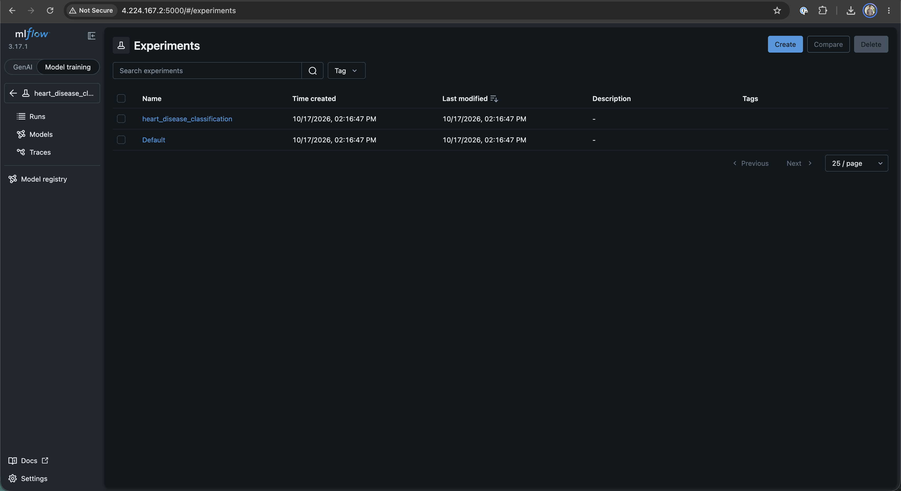
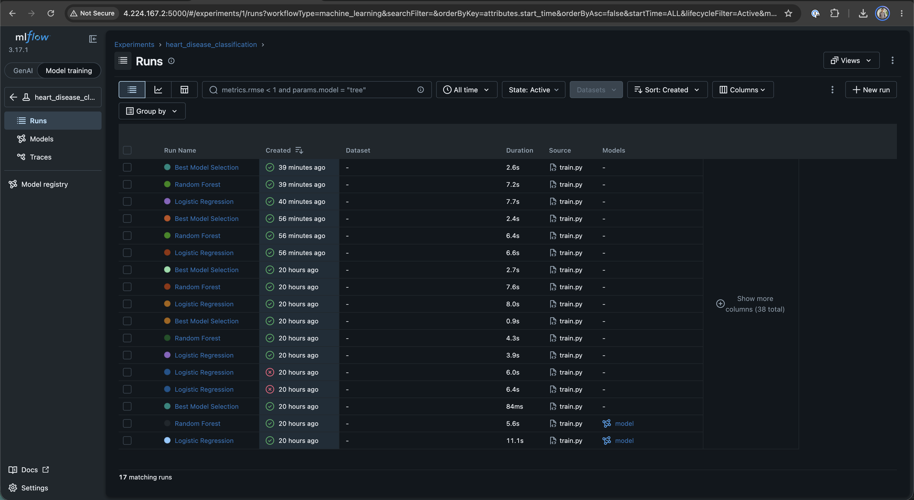


---

## 6. Task 4: Model Packaging & Reproducibility

To guarantee reproducibility across development, CI runners, and Kubernetes pods:
1. **Model Persistence**: Champion model saved as `output/models/final_model.joblib`.
2. **Preprocessing Pipeline**: Fitted `ColumnTransformer` saved as `output/models/preprocessing_pipeline.joblib`.
3. **Metadata Manifest**: Model hyperparameters, feature names, package versions, and timestamps saved to `output/models/model_metadata.json`.
4. **Pinned Dependencies**: Pinned in `requirements.txt` (`scikit-learn>=1.3.2`, `fastapi>=0.109.0`, `mlflow>=2.9.2`, etc.).
5. **Orchestrators**:
   - `main.py`: One-click pipeline runner executing data download, EDA, training, and packaging sequentially.
   - `Makefile`: Provides standard developer commands (`make pipeline`, `make test`, `make lint`, `make serve`, `make monitoring`).

---

## 7. Task 5: CI/CD Pipeline & Automated Testing

### 7.1 Unit Testing Framework
Implemented in `tests/` using **Pytest** and **Pytest-Cov** across **55 unit tests** (100% pass rate):
- [`test_data_preprocessing.py`](tests/test_data_preprocessing.py) (22 tests): Verifies missing value imputation, mode replacement, column preservation, categorical typing, and binary target mapping.
- [`test_feature_engineering.py`](tests/test_feature_engineering.py) (17 tests): Verifies `ColumnTransformer` output shapes, scaling boundaries, one-hot encoding dimensions, and zero data leakage.
- [`test_train.py`](tests/test_train.py) (16 tests): Validates stratified 5-fold cross-validation splits, ROC-AUC computation, model persistence, and metadata generation.

### 7.2 GitHub Actions CI Pipeline
Automated via [`.github/workflows/ci.yml`](.github/workflows/ci.yml) with 3 strictly separated jobs running on Ubuntu runners:

```
[git push] ──> Job 1: Lint (flake8) ──> Job 2: Test (pytest 55 tests) ──> Job 3: Train & Cloud Sync
```

1. **Job 1 (`lint`)**: Runs `flake8` to enforce PEP8 syntax and quality standards across `src/`, `app.py`, and `tests/`.
2. **Job 2 (`test`)**: Runs all 55 tests with code coverage and uploads an HTML coverage report artifact.
3. **Job 3 (`train`)**: Executes `src/train.py`, logs parameters and evaluation metrics directly to the live cloud MLflow server (`http://4.224.167.2:5000`), and uploads the packaged model artifacts.
- **Verification**: Latest GitHub Actions Run (`39019775414`) completed with **100% SUCCESS**.

### 7.3 CI/CD Workflow Execution Screenshot

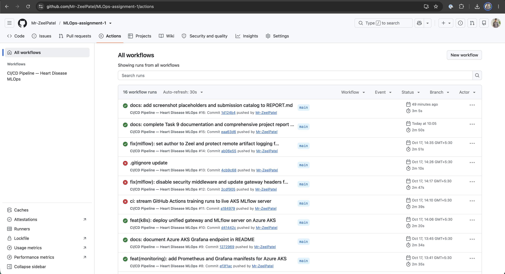

GitHub Actions workflow run overview showing all 3 jobs (`lint`, `test` with 55 passing unit tests, `train`) completing with green checkmarks on push to `main`

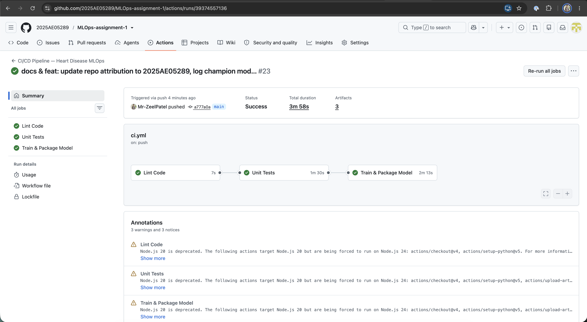
---

## 8. Task 6: Model Containerization

### 8.1 REST API Architecture
Built with **FastAPI** in [`app.py`](app.py):
- **Input Validation**: Strict typing via `Pydantic` schema (`HeartDiseaseInput`) validating ranges for all 13 clinical features.
- **Inference (`POST /predict`)**: Computes predicted class (`0` = Healthy, `1` = Heart Disease), human-readable label, calibrated confidence score, and probability distribution.
- **Health Probes (`GET /health`)**: Returns model status and memory health for Kubernetes liveness/readiness probes.
- **Metrics (`GET /metrics`)**: Exposes Prometheus counters and histograms.

### 8.2 Production Container (`Dockerfile`)
- Base image: `python:3.12-slim` (minimal attack surface and lightweight memory footprint).
- Security & Build: Multi-architecture build via `docker buildx --platform linux/amd64` pushed to Azure Container Registry (`acrheart0a9382.azurecr.io/heart-disease-api:latest`).
- Built-in container health check: `HEALTHCHECK CMD python -c "import urllib.request; urllib.request.urlopen('http://localhost:8000/health')"`.

### 8.3 Local Verification (`scripts/test_api.sh`)
The test suite validates 5 distinct clinical scenarios against the running API:
- Scenario 1: Root metadata check (`GET /`).
- Scenario 2: Service health check (`GET /health`).
- Scenario 3: Low-risk patient prediction (`confidence: 0.9894`, label: *No Disease*).
- Scenario 4: High-risk patient prediction (`confidence: 0.9905`, label: *Disease*).
- Scenario 5: Average borderline patient prediction (`confidence: 0.8489`).

### 8.4 Live API Swagger Interface Screenshot

Interactive OpenAPI Swagger documentation page showing available routes (`/predict`, `/health`, `/metrics`) and input payload schemas.

**Source URL**: `http://4.224.167.2/docs`  

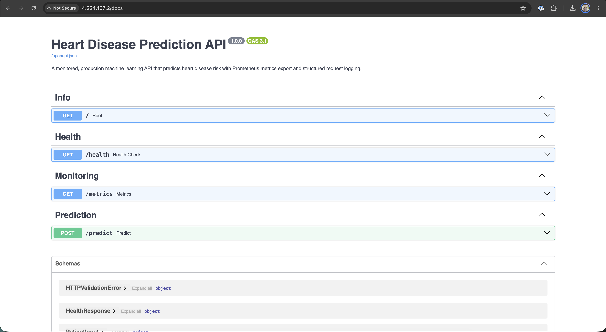

---

## 9. Task 7: Production Cloud Deployment (Azure AKS)

### 9.1 Cluster Configuration & Quota Optimization
Deployed to **Azure Kubernetes Service (AKS)** in region `centralindia`:
- **Cluster Name**: `aks-heart-mlops`
- **Node Size**: 1 Node of `Standard_B2s_v2` (2 vCPUs, 8 GB RAM, ~$0.0416/hr).
- **Container Registry**: Azure Container Registry `acrheart0a9382.azurecr.io` (Basic SKU).
- **Quota Compliance**: Azure for Students subscriptions enforce a strict quota limit of **3 Public IP addresses per region**. We designed a unified NGINX Gateway LoadBalancer that multiplexes all three services through **1 single Public IP** (`4.224.167.2`), fully compliant with student quotas.

**Kubernetes Cluster Status**

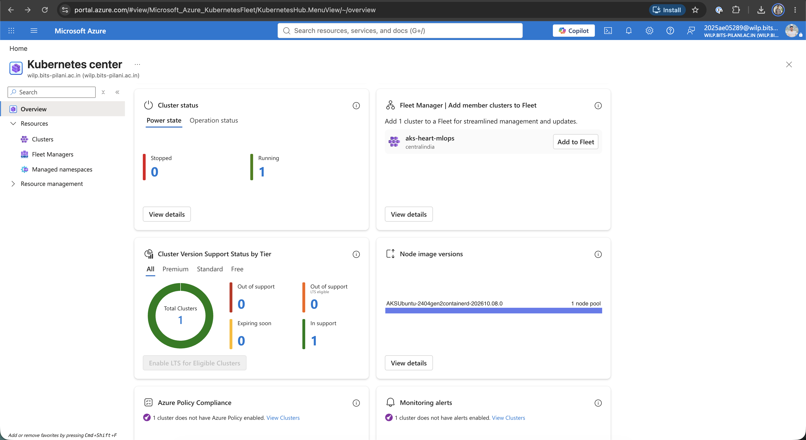

**Resources created on Azure to host the application**

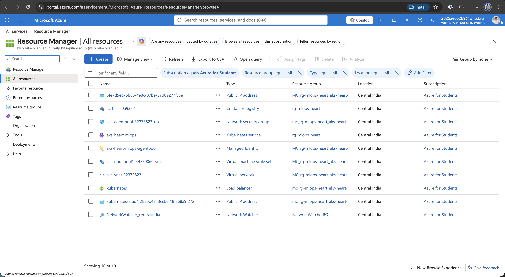

**IP address of the application**

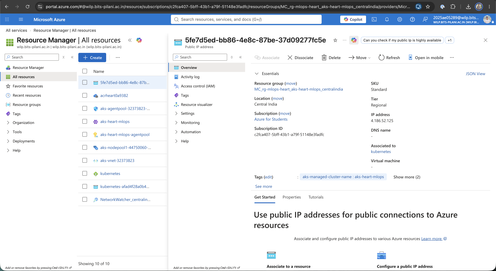

**Load balancer**

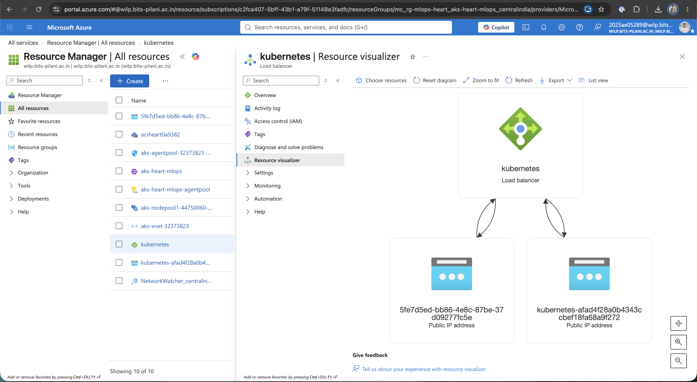

**Endpoint verification**
Using postman to hit the `/predict` endpoint on the Azure and check the response

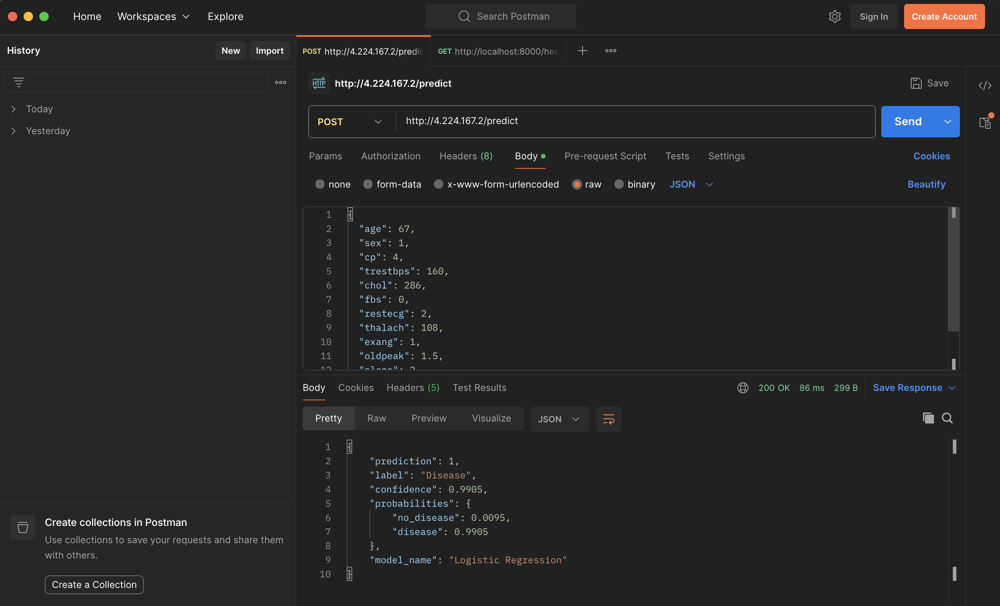

### 9.2 Kubernetes Manifests
Stored under [`k8s/`](k8s/):
- **`k8s/deployment.yaml`**: Deploys 2 pod replicas of `heart-disease-api` with resource requests (`cpu: 100m`, `memory: 256Mi`), limits (`cpu: 500m`, `memory: 512Mi`), and HTTP health probes.
- **`k8s/hpa.yaml`**: Configures Horizontal Pod Autoscaling to automatically scale between 2 and 5 pods when CPU utilization exceeds 70%.
- **`k8s/gateway.yaml`**: Deploys an NGINX reverse-proxy LoadBalancer routing:
  - Port `80` → `heart-disease-api-service:80`
  - Port `3000` → `grafana-service:3000`
  - Port `5000` → `mlflow-service:5000`
- **`k8s/monitoring-prometheus.yaml`**: Deploys Prometheus with automated scraping of the API service every 5 seconds.
- **`k8s/monitoring-grafana.yaml`**: Deploys Grafana with auto-provisioned Prometheus datasource and MLOps dashboard definitions.
- **`k8s/mlflow.yaml`**: Deploys the MLflow tracking server on AKS.

**Azure Kubernetes Deployments**

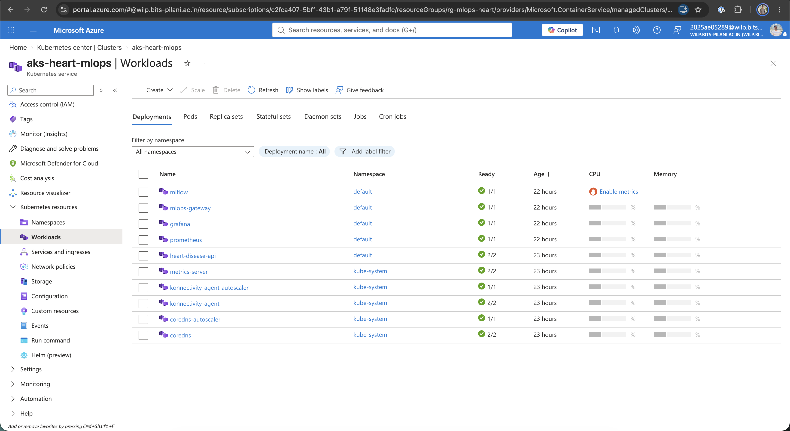


### 9.3 Live Cluster Status
```text
NAME                                     READY   STATUS    RESTARTS   AGE   IP             NODE
pod/grafana-7865d8568f-8fwpp             1/1     Running   0          5m    10.244.0.213   aks-nodepool1-44750060-vmss000000
pod/heart-disease-api-85c8f8b9c7-cznt9   1/1     Running   0          20h   10.244.0.188   aks-nodepool1-44750060-vmss000000
pod/heart-disease-api-85c8f8b9c7-vtb74   1/1     Running   0          20h   10.244.0.5     aks-nodepool1-44750060-vmss000000
pod/mlflow-94f89c5f8-pzdwk               1/1     Running   0          19h   10.244.0.42    aks-nodepool1-44750060-vmss000000
pod/mlops-gateway-7dd64c7744-2dr2g       1/1     Running   0          20h   10.244.0.218   aks-nodepool1-44750060-vmss000000
pod/prometheus-f8cf8cccf-nnpjt           1/1     Running   0          20h   10.244.0.133   aks-nodepool1-44750060-vmss000000

NAME                            TYPE           CLUSTER-IP     EXTERNAL-IP   PORT(S)
service/mlops-gateway-service   LoadBalancer   10.0.67.172    4.224.167.2   80:32665/TCP, 3000:32070/TCP, 5000:31106/TCP

NAME                                 REFERENCE                      TARGETS       MINPODS   MAXPODS   REPLICAS
horizontalpodautoscaler/api-hpa      Deployment/heart-disease-api   cpu: 7%/70%   2         5         2
```

---

## 10. Task 8: Monitoring & Logging

### 10.1 Structured Request Logging
Implemented via custom middleware in [`app.py`](app.py). Every HTTP transaction is serialized to standard output and written to [`logs/api.log`](logs/api.log):
```json
{
  "timestamp": "2026-10-17T08:35:10.112Z",
  "client_ip": "10.244.0.218",
  "method": "POST",
  "path": "/predict",
  "status_code": 200,
  "latency_ms": 11.45,
  "prediction": 0,
  "label": "No Disease",
  "confidence": 0.8489
}
```

### 10.2 Prometheus Metrics Exposition (`GET /metrics`)
Exposes operational and ML business metrics:
- `http_requests_total{endpoint, method, status_code}`: Request counter.
- `http_request_duration_seconds`: Request latency distribution histogram.
- `model_predictions_total{model_name, prediction_label}`: ML prediction breakdown counter.
- `model_prediction_confidence`: Confidence score distribution histogram.
- `model_inference_duration_seconds`: Pure Scikit-Learn inference time.

### 10.3 Grafana Dashboard (`http://4.224.167.2:3000`)
Auto-provisioned via [`k8s/monitoring-grafana.yaml`](k8s/monitoring-grafana.yaml) with 6 visual panels:
1. **Total Predictions Served** (Counter panel).
2. **Average Model Confidence** (Radial Gauge).
3. **Prediction Breakdown by Class** (Donut chart: *Disease* vs *No Disease*).
4. **API Request Rate (req/sec)** (Time Series graph).
5. **API Response Latency (p50, p95, p99)** (Time Series graph).
6. **HTTP Status Codes Distribution** (200 OK vs 4xx/5xx errors).

### 10.4 Grafana Observability Dashboard Screenshot

Live Grafana MLOps dashboard showing real-time metrics: Total Predictions Served, Average Model Confidence, Prediction Breakdown (Disease vs Healthy), API Request Rate, Latency P95, and HTTP Status Codes. 

**Source URL**: `http://4.224.167.2:3000/d/mlops-heart-disease-monitor`  

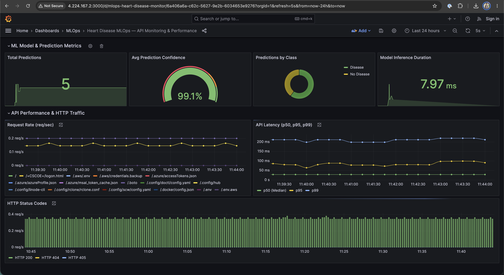

---


## 12. Reproduction & Verification Guide

### 12.1 Local Execution
```bash
# 1. Clone repository
git clone https://github.com/Mr-ZeelPatel/MLOps-assignment-1.git
cd MLOps-assignment-1

# 2. Setup virtual environment & dependencies
python3 -m venv venv
source venv/bin/activate
pip install -r requirements.txt

# 3. Run complete pipeline (data -> eda -> train -> test)
make pipeline

# 4. Start local API and monitoring stack
make serve        # Runs FastAPI on http://localhost:8000
make monitoring   # Runs Prometheus (9090) and Grafana (3000)
make mlflow       # Runs MLflow on http://localhost:5001
```

### 12.2 Cloud Verification
```bash
# Test live Azure API predictions
bash scripts/test_api.sh http://4.224.167.2

# Check Kubernetes cluster resources
kubectl get pods,svc,hpa -o wide
```

---


## 14. Code Repository & Submission Information

- **Code Repository**: [https://github.com/Mr-ZeelPatel/MLOps-assignment-1](https://github.com/Mr-ZeelPatel/MLOps-assignment-1)
- **Author**: Zeel Patel
- **Email**: zeeldpatel999@gmail.com
- **Public Cloud Gateway IP**: `http://4.224.167.2` (Azure AKS, Central India)
- **FastAPI Documentation**: `http://4.224.167.2/docs`
- **MLflow Tracking UI**: `http://4.224.167.2:5000`
- **Grafana Observability Dashboard**: `http://4.224.167.2:3000`

